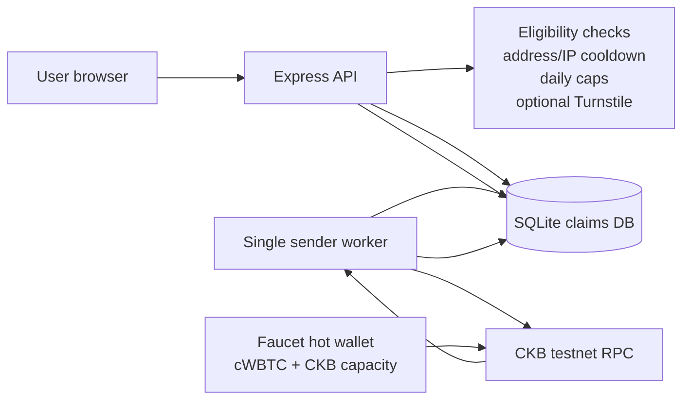
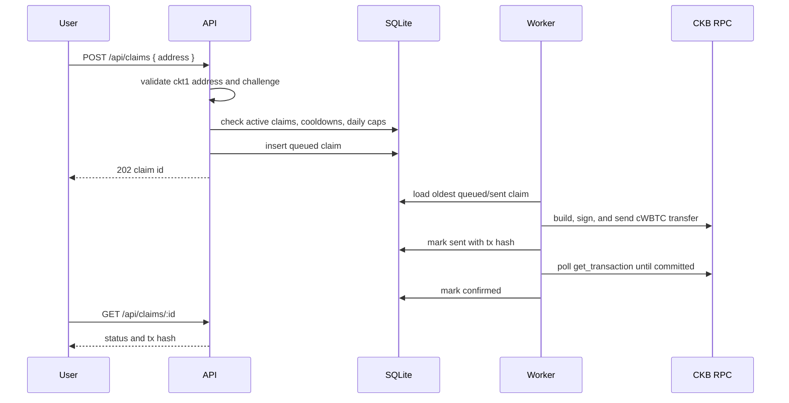

# CKBolt cWBTC Faucet

Public testnet faucet for `cWBTC`, the CKB xUDT used as fake wrapped BTC in the Fiber CCH demo. It is a plain testnet UDT with 8 decimals. For the demo convention, `1 raw cWBTC = 1 satoshi`, so `1 cWBTC = 100,000,000 raw units`.

This is CKBolt's fork of [RetricSu/cwbtc-faucet](https://github.com/RetricSu/cwbtc-faucet). CKBolt testers use cWBTC to swap test BTC on Lightning for cWBTC on Fiber, and back ([CKBolt guide](https://ckbolt.texlabs.org/app/guide)). Differences from upstream:

- `0.01 cWBTC` per claim (`CLAIM_AMOUNT_RAW=1000000`), enough for many 1,000 to 20,000 sat CKBolt swaps.
- `147 CKB` per recipient cWBTC cell (`UDT_CELL_CAPACITY_CKB`) instead of a hard-coded 200: the cell occupies 146 bytes, plus a 1 CKB margin. See `src/ckb/capacity.ts`.
- Tighter demo caps: IP cooldown 30 minutes, 3 claims per IP and 50 claims per day in total.
- Docker Compose builds the image locally (`ckbolt/cwbtc-faucet:local`, never pulled) and publishes it on `127.0.0.1` only.
- Deployment runbook for the CKBolt VPS and Cloudflare Tunnel: [docs/CKBOLT-DEPLOY.md](docs/CKBOLT-DEPLOY.md).

## Existing cWBTC

The original issuance artifacts are still present locally:

- Workspace copy: `/Users/retric/Documents/Codex/2026-07-06/ban/work/cch-wbtc-udt`
- Desktop copy: `/Users/retric/Desktop/cch-wbtc-udt`
- Issuer file: `issuer.json` has the issuer private key field.
- Issue result: `issue-result.json`

Do not deploy the issuer key directly. Fund a dedicated faucet hot wallet with cWBTC plus enough CKB capacity, then mount that hot-wallet key as the `faucet_private_key` Docker secret.

Token details:

```json
{
  "name": "CCH Wrapped BTC",
  "symbol": "cWBTC",
  "decimals": 8,
  "supply_raw": "340282366920938463463374607431768211455",
  "type_script": {
    "code_hash": "0x25c29dc317811a6f6f3985a7a9ebc4838bd388d19d0feeecf0bcd60f6c0975bb",
    "hash_type": "type",
    "args": "0x9a1086531ed6dc69e0bd44cef5278e03faf3015b31aff60b08fb87663ce8507100000000"
  }
}
```

## Architecture



The important operational detail is the worker. CKB UDT transfers spend a live cell and create a change cell. If the faucet sends concurrent transactions from the same cWBTC cell, one of them will conflict. This service stores claims in SQLite, sends one transaction at a time, and waits until the transaction is committed before sending the next one.

## Claim Flow



## Anti-Sybil v1

This is intentionally modest, but it is durable enough for a real public testnet service:

- one pending claim per address
- address cooldown
- IP cooldown using salted IP hashes
- per-address daily cap
- per-IP daily cap
- global daily cap
- optional Cloudflare Turnstile
- persistent claim history across restarts

The next natural upgrade is Redis/Postgres plus Turnstile enabled by default. If abuse appears, add GitHub OAuth or require a small CKB capacity proof before claiming.

## Run Locally

```bash
npm install
cp .env.example .env
npm run dev
```

The server listens on `http://localhost:3008` by default and serves both the API and the small faucet page.

For local worker testing, set `FAUCET_PRIVATE_KEY_FILE` to a file containing a dedicated faucet hot-wallet key. Direct secret environment variables remain supported for backward compatibility, but file-based secrets take precedence.

Useful endpoints:

- `GET /health`
- `GET /api/info`
- `GET /api/balance`
- `POST /api/claims`
- `GET /api/claims/:id`
- `GET /api/admin/summary` with `Authorization: Bearer $ADMIN_TOKEN`

## Run With Docker

Docker Compose is the recommended production runtime. It runs the service as the unprivileged `node` user, checks `/health`, and persists SQLite state in the `faucet-data` volume.

```bash
./scripts/init.sh
# Fund the printed address with testnet cWBTC and CKB first.
docker compose up -d --build
docker compose ps
```

The initializer copies `.env.example` to `.env`, builds `ckbolt/cwbtc-faucet:local` from the checkout if it is missing, creates a dedicated faucet hot wallet inside it with no network access, and generates the other runtime secrets. It is safe to rerun and does not overwrite existing values. It prints only the public CKB testnet address; the private key stays in `secrets/faucet_private_key`. The `secrets/` directory uses mode `0700`; files inside use mode `0644` so Docker Compose can mount them into the unprivileged container.

Before a public launch, set `PUBLIC_BASE_URL` and `CORS_ORIGIN` in `.env`. Compose mounts the secret files read-only under `/run/secrets`; raw secret values are not included in the container environment. For a production host, the same files can later be moved to the team's secret manager without changing the application.

Compose always builds the image from the current checkout (`pull_policy: build`); it never pulls `ghcr.io/retricsu/cwbtc-faucet`, and `docker compose pull` skips the service.

The service is published on `127.0.0.1:3008` only, for a reverse proxy or tunnel on the same host. Set `FAUCET_PORT` in `.env` when the host port needs to differ. SQLite lives at `/app/data/faucet.sqlite` inside the named volume and survives image replacement or container recreation.

Run exactly one worker-enabled replica. The current queue and SQLite database are designed for one serialized CKB sender; horizontal scaling requires a shared database and a distributed worker lock.

To inspect logs or stop the service:

```bash
docker compose logs -f faucet
docker compose down
```

Do not add `-v` to `docker compose down` unless the claim history is intentionally being deleted.

## Container Publishing

On this fork, GitHub Actions runs the TypeScript checks on pushes, tags and pull requests, and publishes an image only when the workflow is started by hand (Actions tab, Run workflow). The image name comes from the repository, so a manual run publishes `ghcr.io/longdevbf/cwbtc-faucet`, never the upstream namespace. The CKBolt deployment does not use it: the VPS builds `ckbolt/cwbtc-faucet:local` from the checkout.

- published manifests support both `linux/amd64` and `linux/arm64`
- every published image includes a GitHub artifact provenance attestation

The workflow uses the repository-scoped `GITHUB_TOKEN`; no long-lived registry password is required.

## Deployment Notes

1. Run `./scripts/init.sh` and copy the printed public faucet address.
2. Transfer cWBTC from the issuer wallet to that address.
3. Deposit enough CKB into the address. Each claim creates an xUDT cell holding `UDT_CELL_CAPACITY_CKB` (147 CKB by default; the minimum is 146) plus a tx fee of a few thousand shannons. The recipient receives that CKB with the cWBTC.
4. Set the public URL values in `.env`, then start the service:

```bash
docker compose up -d --build
```

Monitor:

- `GET /api/balance` for rough claim capacity.
- `GET /api/admin/summary` for stuck or failed claims.
- process logs for worker errors.

If a claim is stuck in `sent`, the worker will retry confirmation polling on restart. If it is stuck in `processing` after a crash before sending, inspect logs and either mark it `queued` manually or mark it `failed` in SQLite.

See [docs/OPERATIONS.md](docs/OPERATIONS.md) for the handoff runbook.

## Dependency Note

The faucet uses `@ckb-ccc/ccc`, matching the original cWBTC issuance scripts. `npm audit --omit=dev` currently reports low-severity transitive findings in CCC's wallet adapter dependency chain; recheck before public launch and upgrade CCC when a clean release is available.
